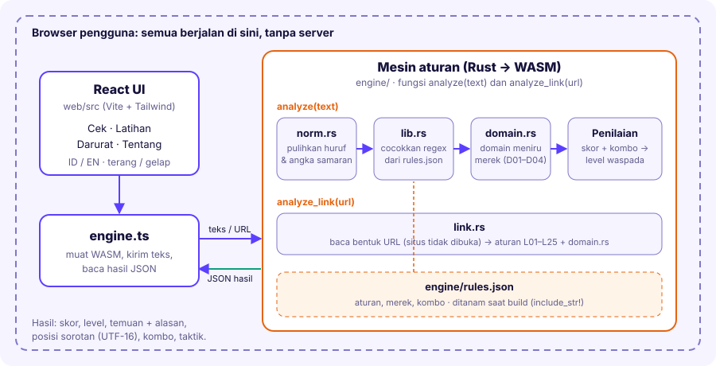

# JEDA: ragu? jeda dulu, cek dulu

Aplikasi web untuk **MIT-Week 2026** (studi kasus *The Trust Trap*) yang membantu orang mengenali pesan dan tautan penipuan, berlatih menghadapinya, dan tahu apa yang harus dilakukan kalau sudah terlanjur. Mesin pendeteksinya berbasis aturan, jadi setiap temuan datang dengan **alasan yang bisa dijelaskan**, bukan skor misterius.

**Demo langsung: https://jeda-kalibata.vercel.app/**

> Semua analisis berjalan di browser (Rust yang dikompilasi ke WebAssembly). Teks dan tautan yang ditempel pengguna **tidak dikirim ke server mana pun**.



## Fitur

| Menu | Peran | Isi |
|---|---|---|
| **Cek** | Recognize | Tempel pesan atau tautan, dapat skor, level waspada, kalimat yang disorot, dan alasan tiap temuan. |
| **Latihan** | Learn | Simulasi chat bercabang: lowongan palsu, kurir/APK, teman minta transfer, pinjol, investasi, love scam. Tiap pilihan diberi umpan balik dan taktik penipunya. |
| **Darurat** | Act | Langkah untuk empat situasi (sudah transfer, sudah kirim OTP/PIN, klik APK, diancam), kanal pelaporan resmi, dan pesan peringatan siap bagikan. |
| **Tentang** | | Cara kerja, cara skor dihitung, dan batasan. |

Lainnya: dua bahasa (Indonesia dan Inggris), mode terang dan gelap, dan progres Latihan yang tersimpan di perangkat.

## Cara kerja mesin

1. **Normalisasi** (`norm.rs`): teks dipulihkan dari trik penyamaran sebelum dicocokkan, dengan peta posisi kembali ke teks asli supaya sorotan tetap tepat. Yang dipulihkan: huruf kembaran (Kiril, Yunani, fullwidth, huruf tebal Unicode, berlingkar), karakter tak terlihat, tanda sisipan (`mai'n`, `GAC/OR`), angka pengganti huruf (`s3gera`, `0TP`), huruf berulang, dan huruf terpisah (`o t p`). Tautan sengaja tidak dirusak.
2. **Pencocokan aturan** (`lib.rs` + `rules.json`): tiap aturan dihitung **sekali per teks**. Kalimat imbauan seperti "jangan berikan kode OTP" diabaikan lewat `unless` dan `unless_after`.
3. **Pemeriksaan domain** (`domain.rs`): mendeteksi domain yang meniru merek (angka pengganti huruf, beda satu huruf, huruf non-Latin, merek + kata tambahan).
4. **Pemeriksa tautan** (`link.rs`): hanya membaca **bentuk** URL (situs tidak dibuka): `@` pengecoh, alamat IP, pemendek tautan, file APK, platform hosting gratis, domain bernuansa judi, dan lainnya.
5. **Penilaian**: bobot dijumlahkan, ditambah bonus kombo (misalnya OTP + urgensi) dan bonus bila 3 taktik atau lebih muncul bersamaan.

| Skor | Level |
|---|---|
| 0 | `tidak_ditemukan` |
| 1 sampai 3 | `ringan` |
| 4 sampai 7 | `sedang` |
| 8 atau lebih | `tinggi` |

Satu temuan berbobot 5 (OTP, PIN, ancaman sebar data) otomatis membuat skor minimal 4. Masukan dibatasi 10.000 karakter.

Total ada **63 aturan pola kata** (28 Indonesia, 35 Inggris) dan daftar 39 merek untuk pemeriksa domain. Bobot dan ambang di atas adalah heuristik penyusun yang **belum dikalibrasi** dengan data nyata. Dasar lengkapnya ada di [docs/DASAR-PENYUSUNAN.md](docs/DASAR-PENYUSUNAN.md).

### Kelompok aturan

| Awalan | Cakupan |
|---|---|
| `R` | Modus penipuan umum berbahasa Indonesia |
| `E` | Modus penipuan berbahasa Inggris |
| `J` | Judi online (bahasa gaul, janji menang, saldo gratis) |
| `N` | Umpan saldo/hadiah palsu dan ajakan klik tautan |
| `D` | Domain meniru merek (dari `domain.rs`) |
| `L` | Bentuk tautan (dari `link.rs`) |

## Dasar ilmiah dan hasil uji

Setiap keputusan desain dicatat sebagai **bersumber**, **interpretasi penyusun**, atau **belum divalidasi**. Dokumen lengkap: [docs/DASAR-PENYUSUNAN.md](docs/DASAR-PENYUSUNAN.md).

| Komponen | Dasar |
|---|---|
| 8 label taktik | Stajano dan Wilson (2011), prinsip pengaruh Cialdini; "Rasa takut" dan "Isolasi" adalah interpretasi penyusun |
| Skor aditif dan ambang | Preseden filter spam SpamAssassin; bobot ordinal 1 sampai 5, belum dikalibrasi |
| 6 skenario Latihan | Modus terbanyak di laporan OJK/IASC (mis. 23.469 laporan lowongan kerja, data Jan 2026) |
| Langkah Darurat | Kanal resmi OJK, Komdigi, Polri (dicek 28 Okt 2026) |

Uji **held-out** (pesan baru yang tidak dipakai menyetel aturan): sekitar separuh penipuan terdeteksi (Indonesia 5 dari 10, Inggris 6 dari 10) dan 0 dari 12 pesan sah salah ditandai. Contohnya sedikit dan ditulis oleh pembuat aturan, jadi ini perkiraan kasar, bukan akurasi dunia nyata. Korpus regresi (`engine/tests/korpus.rs`) hanya mencegah aturan mundur, bukan ukuran akurasi.

```bash
cd engine
cargo test --test korpus -- --nocapture
cargo test --test heldout -- --ignored --nocapture
```

## Struktur proyek

```
jeda/
├── engine/                 # Rust, dikompilasi ke WASM
│   ├── rules.json          # aturan, daftar merek, kombo
│   └── src/
│       ├── lib.rs          # pemuat aturan, penilaian, ekspor WASM, uji
│       ├── norm.rs         # normalisasi teks + peta posisi
│       ├── domain.rs       # pemeriksa domain peniru merek
│       └── link.rs         # pemeriksa tautan
│   └── tests/              # korpus.rs (regresi), heldout.rs (laporan held-out)
├── web/                    # React + Vite + Tailwind v4 + GSAP
│   └── src/
│       ├── App.tsx         # navigasi dan tema
│       ├── engine.ts       # pemuat WASM
│       ├── content.ts      # tingkat waspada, contoh pesan
│       ├── i18n            # kamus Indonesia dan Inggris
│       ├── pages/          # Cek, Latihan, Darurat, Tentang
│       ├── components/
│       ├── data/           # scenarios, emergency, facts, en
│       └── wasm/           # hasil build wasm-pack (di-commit)
└── docs/
    ├── arsitektur.svg
    └── DASAR-PENYUSUNAN.md # sumber, bobot, skenario, hasil uji
```

## Menjalankan

Prasyarat: Node 20+, Rust stable, `wasm-pack`, dan target `wasm32-unknown-unknown`.

```bash
rustup target add wasm32-unknown-unknown
cargo install wasm-pack

cd engine && cargo test          # uji mesin aturan
cd ../web
npm install
npm run build:wasm               # hasil ke web/src/wasm (COMMIT hasilnya)
npm run dev
```

`npm` harus dijalankan dari folder `web`, bukan dari root repo.

Kalau skrip `build:wasm` belum ada, bangun manual dari folder `engine`:

```bash
wasm-pack build --target web --release --out-dir ../web/src/wasm --out-name jeda_engine
```

`web/src/engine.ts` memuat `./wasm/jeda_engine.js`, jadi nama keluaran harus `jeda_engine`. Jika folder `wasm` belum ada, aplikasi menampilkan galat `ENGINE_NOT_BUILT`.

## Mengubah atau menambah aturan

`rules.json` **ditanam ke WASM saat build** (`include_str!`). Setiap perubahan butuh `cargo test` lalu `npm run build:wasm`, dan hasilnya disalin ke `web/src/wasm`. Setelah itu hard refresh browser (Ctrl+Shift+R) karena `.wasm` lama sering ter-cache.

Bidang aturan:

| Bidang | Fungsi |
|---|---|
| `id`, `tactic`, `weight`, `why` | Identitas, kelompok taktik, bobot, dan penjelasan untuk pengguna |
| `any_of` | Daftar regex; cukup salah satu cocok |
| `also_requires` | Regex pendamping; minimal satu harus ada di teks |
| `unless` | Pola penyangkalan **sebelum** temuan ("jangan berikan...") |
| `unless_after` | Pola penyangkalan **sesudah** temuan ("tidak pernah meminta") |
| `squeeze` | Pola untuk teks tanpa spasi dan tanda baca, untuk kata yang sengaja dipecah (`KEME NAN GAN`) |

Catatan penting:

- **Regex Rust tidak mendukung lookahead/lookbehind** (`(?=...)`, `(?<=...)`). Satu pola tidak valid membuat mesin gagal dimuat dan semua uji ikut gagal. Gunakan grup `(?:...)` atau `\b`.
- Di JSON, backslash ditulis ganda: `\\b`, `\\.`.
- Daftar pemendek tautan ada di **tiga tempat**: `R27` dan `N08` di `rules.json`, serta `SHORTENERS` di `link.rs`. Ubah semuanya sekaligus.
- Alasan versi Inggris ada di `web/src/data/en.ts` (`WHY_EN`, kunci: id aturan). Tambahkan terjemahan untuk aturan baru.
- Tambahkan uji di `lib.rs` atau `link.rs`, termasuk contoh pesan sah yang **tidak boleh** ditandai.

## Mengubah konten edukasi

| Ingin mengubah | Edit |
|---|---|
| Skenario Latihan | `web/src/data/scenarios.ts` (Inggris: `en.ts`) |
| Langkah Darurat | `web/src/data/emergency.ts` (Inggris: `en.ts`) |
| Statistik, kanal pelaporan, tanggal pengecekan | `web/src/data/facts.ts` (`CHECKED`) |
| Contoh pesan dan teks level waspada | `web/src/content.ts` |

Kanal pelaporan dan angka statistik dapat berubah. Perbarui `CHECKED` setiap kali data diverifikasi ulang.

## Deploy (Vercel)

Situs produksi: https://jeda-kalibata.vercel.app/

Hasil build WASM di-commit, jadi server deploy cukup menjalankan `npm run build` di folder `web`. Aturan rewrite SPA sudah tersedia (`vercel.json`, `public/_redirects`).

## Privasi

- Pesan dan tautan tidak pernah meninggalkan browser.
- `localStorage` hanya dipakai untuk pilihan tema dan progres Latihan.
- Pemeriksa tautan tidak membuka situs yang dicek.

## Batasan

Berbasis pola kata, bukan pembuktian. Hanya mengenali bahasa Indonesia dan Inggris, dan paraphrase yang disusun ulang sering lolos. Pesan sah bisa memicu aturan, dan penipu yang rapi bisa lolos. Pemeriksa tautan tidak melihat isi halaman, umur domain, atau reputasi. Hasil tidak pernah menyatakan sebuah pesan "aman"; kalau ragu, verifikasi lewat kanal resmi yang dicari sendiri.

## Sumber daya pihak ketiga

React, Vite, Tailwind CSS, GSAP, regex, serde, wasm-bindgen, dan font Bricolage Grotesque (Google Fonts, OFL). Statistik dan rujukan kanal pelaporan bersumber dari OJK dan pemberitaan, tercantum di `web/src/data/facts.ts`.